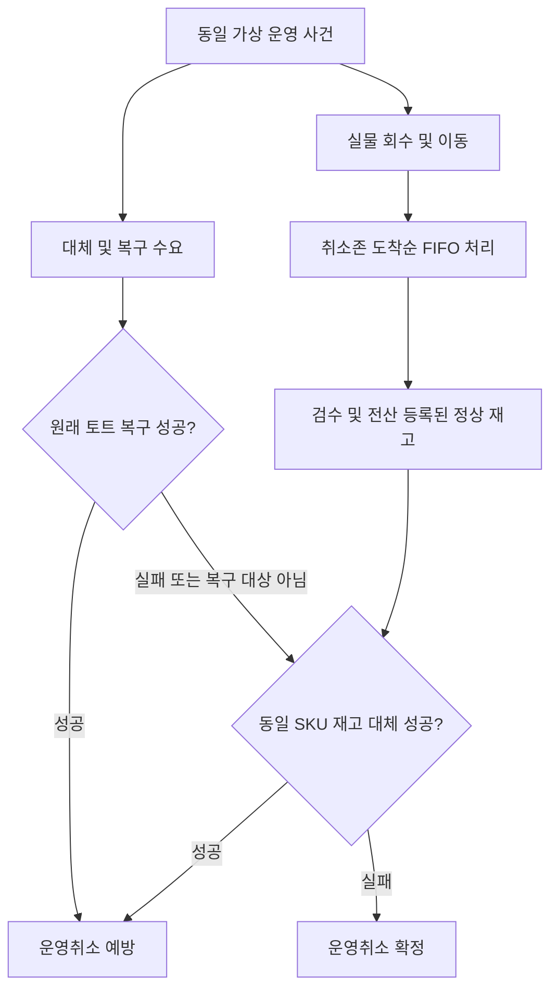

# 물류 취소 상품 재사용 프로세스 개선

> 취소존에 남아 있는 정상 상품을 제때 찾아 활용하면 불필요한 운영취소와 재집을 얼마나 줄일 수 있을까?


[](./main_analysis.ipynbhttps://shane-son.github.io/logistics-data-analysis/#project)
[](./main_analysis.ipynb)

<!-- 배포 전: 위 Portfolio 주소의 YOUR-GITHUB-ID와 YOUR-REPO를 실제 GitHub Pages 주소에 맞게 수정하세요. -->

**현장 경험 기반 시뮬레이션 · 1차 가안 (v14)**  
실제 센터의 운영 로그나 자동화 도입 성과가 아닌, 가정된 동일 운영 조건에서 개선 가능성을 비교한 프로젝트입니다.

## 01. 주요 분석 결과

| 핵심 지표 | 수동 처리 | 자동화 | 개선 효과 |
| :--- | ---: | ---: | ---: |
| 정상 재고 재사용률 | 47.92% | 54.18% | **+6.26%p** |
| 운영취소 확정 건수 | 977 | 826 | **−15.46%** |
| 평균 조회 준비 지연 | 11.91분 | 0.07분 | **−11.84분** |

기준 시나리오에서 운영취소 대상 2,141개 중 자동화로 151개의 추가 운영취소를 예방할 수 있었습니다. 상세 결과는 [웹 포트폴리오](./main_analysis.ipynbhttps://shane-son.github.io/logistics-data-analysis/#main-results)에서 확인할 수 있습니다.

## 02. 프로젝트 배경 및 문제 정의

물류센터 출고 공정에서는 오집·미집·파손·토트분실 등의 문제가 발생하면 필요한 상품을 다시 집품할 수 있도록 내부 취소 및 재할당을 진행합니다. 그러나 취소존에는 다른 오류나 집품 후 고객취소로 회수된 정상 상품이 존재할 수 있습니다.

현장 업무 경험을 바탕으로, 재집을 진행하기 전에 기존 정상 재고를 찾아 대체할 수 있는 기회가 처리 지연과 실물 탐색 누락으로 인해 사라질 수 있다는 점에 주목했습니다.

**분석 질문:** 취소 상품 처리 및 재고 검색을 자동화하면 동일한 운영 오류에 대해 재사용률을 높이고 내부 운영취소를 줄일 수 있는가?

**개선 방향:** 실물 취소처리의 자동화와 상품·SKU·위치 정보의 전산화를 통해 관리자에게 재사용·복구 판단 정보를 제공합니다. 고객의 최종 구매 취소 자체를 줄이거나 관리자의 판단을 자동으로 대체하는 것은 분석 범위가 아닙니다.

## 03. 데이터 구성 및 주요 가정

실제 운영 로그를 사용하지 않고 상품 유닛, 토트, 오류 발생, 이동 및 처리시간을 가상으로 생성했습니다. 수동·자동화 시나리오는 동일 사건을 공유합니다.

| 항목 | 기준 시나리오 |
| :--- | :--- |
| 일일 집품 계획 | 150,000개 유닛 |
| 고객취소·운영 오류 후보 | 7,500개 (계획량의 5%, 확정 취소율 아님) |
| 고객취소 / 운영 오류 | 5,246개 / 2,254개 |
| 집품 후 고객취소 | 525개 (전체 고객취소의 10% 가정) |
| 대체·복구 수요 | 2,141개 (공급 전용 과집 113개 제외) |
| 상품 및 토트 구성 | 상품 500종 × SKU 3개, 토트당 계획 유닛 10~20개 |
| 운영시간 | 08:00~익일 02:00 |

### 오류별 재고 수요와 공급 구분

| 유형 | 발생 | 대체·복구 수요 | 정상 공급 후보 |
| :--- | ---: | ---: | :--- |
| 과집 | 113 | 0 | 가능 |
| 타 토트 오집 | 1,163 | 1,163 | 가능 |
| 부족집품(미집) | 547 | 547 | 없음 |
| 집품파손 | 88 | 88 | 없음 |
| 리빈파손 | 120 | 120 | 없음 |
| 토트분실 | 223 | 223 | 회수·할당 해제 시 가능 |
| 집품 후 고객취소 | 525 | 0 | 가능 |

특히 타 토트 오집은 원래 토트의 부족 수요와 잘못 담긴 실물의 공급을 분리하되 동일 오류 사건으로 연결했습니다. 실물 처리량을 중복 계산하지 않으며, 파손된 실물은 정상 재고 공급원에서 제외합니다.

## 04. 시뮬레이션 설계



*위 도식은 수요와 공급의 연결 관계를 요약한 것으로, 기존 WMS에서 복구된 토트는 취소존을 경유하지 않습니다.*

| 시나리오 변수 | 수동 | 자동화 |
| :--- | :--- | :--- |
| 취소 처리능력 | 200개/h | 420개/h |
| 위치정보 확인 확률 | 60% | 95% |
| 수동 실물 탐색 누락 | 10% | 전산 직접 검색 시 미적용 |
| 지연에 따른 수동 대체 시도 | 30분 이하 100%, 30~70분 70%, 70분 초과 15% | 전산 직접 검색 시 미적용 |
| 회수 실물 검수 통과 | 90% | 90% |

기존 WMS 경로 추적 가능 확률 80%를 공통 적용하고, 자동화에서도 도구 미사용·위치 미확인 시 수동 탐색으로 전환합니다. 위 값은 실측값이 아닌 모델 가정입니다.

### 4-1. 실물 도착순 FIFO 처리

취소존에 실제로 도착한 상품만 처리 용량을 소비하도록 구현했습니다. 실물이 없는 미집 및 오집 부족 수요는 이전 실물 작업의 대기를 참조하지만 별개의 실물 처리시간은 부과하지 않습니다. 수동 시나리오에는 간헐적인 작업 휴지도 반영합니다.

```python
physical=job in ('normal_error','lost_physical','late_physical')
consumes=physical or include_virtual_work
started=max(entry,available)
completed=started+pd.Timedelta(minutes=time_per_case if consumes else 0)
if consumes:
    available=completed
    if physical:
        out.at[idx,'physical_fifo_service_count']+=1
        out.at[idx,'physical_fifo_service_min']+=time_per_case
    else:
        out.at[idx,'virtual_fifo_service_count']+=1
    batch_count+=1
    if process_type=='manual' and batch_count>=batch_limit:
        available+=pd.Timedelta(minutes=rng.uniform(2.0,5.0))
        batch_count=0
        batch_limit=rng.randint(30,50)
```

집품 후 고객취소 실물 525개도 동일 큐에 편입하며, 수동·자동화 모두 기준일의 실물 처리량은 2,104개로 고정합니다.

### 4-2. 동일 SKU 매칭 및 실물 중복 소비 방지

검수·등록·할당 해제가 완료된 정상 재고 중 `product_id`와 `sku_id`가 모두 일치하는 후보를 조회합니다. 동일 운영일의 기존 가용 재고를 우선하고, 없으면 조회 준비시각 이후 30분 이내에 가용해지는 재고까지 탐색합니다.

```python
# group: 동일 product_id + sku_id로 묶인 가용시각순 공급 후보
cand = None
cutoff = target_event_time + pd.Timedelta(minutes=MATCH_WINDOW_MIN)
for candidate in group:
    if candidate['available_time'] > cutoff:
        break
    if (candidate['_row_key'] not in used_source_ids and
        candidate['order_id'] != row['order_id'] and
        candidate['operating_day'] == day):
        cand = candidate
        break
# ... 탐색 성공 및 재사용 시도 조건을 통과한 경우에만 아래 실행
used_source_ids.add(int(cand['_row_key']))
```

매칭 성공 후보의 실물 ID를 기록해 하나의 실물이 여러 수요에 중복 사용되는 것을 방지했습니다. 원토트 복구와 정상 재고 대체 또한 중복 집계하지 않습니다.

### 4-3. 동일 사건 기반 시나리오 비교

처리 방식만 변경해 시간 흐름, 검수·등록, 재고 매칭, 운영취소 판정을 다시 수행합니다. 검색툴 활용률을 변경하는 민감도 분석에도 같은 함수를 사용합니다.

```python
def complete_scenario(base_df, process_type='manual', tool_usage_rate=1.0):
    # 도구 활용률이 바뀌면 토트 복구, 취소 큐, 공급원, 다른 SKU 대체를 모두 재실행.
    event = build_scenario_pre_match(base_df,process_type,tool_usage_rate)
    event = add_physical_flags(event)
    event = assign_reuse_with_time_window(event,process_type,tool_usage_rate)
    event = add_operational_outcomes(event)
    return event
```

> 코드 스니펫은 v14 Notebook의 STEP 4·5·11 핵심 로직을 발췌한 것으로, 문맥 의존 변수가 있어 단독 실행용은 아닙니다. 전체 구현은 [Jupyter Notebook](./main_analysis.ipynb)에서 확인할 수 있습니다.

## 05. 결과 해석 및 민감도 분석

| 세부 지표 | 수동 | 자동화 | 변화 |
| :--- | ---: | ---: | ---: |
| 정상 재고 대체 | 1,026 | 1,160 | +134 |
| 원토트 복구 | 138 | 155 | +17 |
| 운영취소 예방 합계 | 1,164 | 1,315 | +151 |
| 운영취소 예방률 | 54.37% | 61.42% | +7.05%p |
| 평균 실물 FIFO 대기 | 11.54분 | 0.06분 | −11.48분 |
| 평균 재고 탐색 시간 | 2.37분 | 0.62분 | −1.75분 |

- 재사용률 = 정상 재고 대체 건수 / 대체·복구 수요 2,141개
- 운영취소 예방률 = (정상 재고 대체 + 원토트 복구) / 2,141개
- 운영취소 감소율 = (수동 확정 − 자동화 확정) / 수동 확정 977개

타 토트 오집에서 운영취소가 132개 감소하여 전체 개선폭 151개의 가장 큰 부분을 차지했습니다. 반면 미집은 1개 증가했습니다. 재사용할 정상 재고가 한정되어 있는 조건에서 모든 오류의 개선이 동시에 보장되지는 않습니다. 사유별 변화의 독립 기여도는 추가 검증이 필요합니다.

### 검색툴 활용률별 민감도

| 검색툴 활용률 가정 | 자동화 재사용률 | 자동화 운영취소 | 수동 대비 감소율 |
| ---: | ---: | ---: | ---: |
| 70% | 52.83% | 859 | 12.08% |
| 80% | 53.25% | 850 | 13.00% |
| 90% | 53.67% | 838 | 14.23% |
| 100% | 54.18% | 826 | 15.46% |

도구 활용률을 낮춘 조건에서도 운영취소 감소 방향이 유지되었습니다. 별도의 상품 종류·수요 집중도 6개 가정에서는 재사용률이 5.79~6.07%p 증가했습니다. 이 범위는 통계적 신뢰구간이 아닌 시나리오 비교 결과입니다.

## 06. 결론 및 한계

기존 정상 재고의 활용도를 높이는 방식은 불필요한 운영취소·재할당을 줄이는 개선안이 될 수 있습니다. 우선 취소존의 전산 등록 및 위치 검색을 개선하고, 실제 운영 데이터로 처리 지연과 매칭 성공률을 확인하는 파일럿을 제안합니다.

**한계 및 후속 검증**

- 가상 데이터 기반이며, 처리능력·등록률·탐색확률 등 주요 가정의 실측 검증이 필요합니다.
- 실물 처리량 2,104개는 현장 경험상의 일평균 약 2,500개보다 적습니다.
- 무실물 검색·행정 업무에 필요한 추가 처리 용량, 다품목 주문 전체 재집 및 토트 전체 동시 분실은 모델링하지 않았습니다.
- 처리속도, 공급 변화, 검색 누락 등의 독립 기여도는 별도로 분해하지 않았습니다.
- 재진열 지연 감가 및 교육 시나리오는 확장 분석으로 분리하며 메인 개선 효과에 합산하지 않습니다.

## 07. 분석 자료 및 재현 방법

| 자료 | 링크 |
| :--- | :--- |
| 웹 포트폴리오 | [메인 분석 페이지 열기](https://shane-son.github.io/logistics-data-analysis/) |
| 분석 코드 | [Jupyter Notebook v14](./main_analysis.ipynb) |

Python 환경에서 `pandas`, `numpy`, `matplotlib`, `jupyter`를 설치하고 Notebook을 위에서부터 실행하면 가상 데이터 생성부터 결과 산출까지 재현할 수 있습니다. 기존 v14 검증 기록상 34개 코드 셀 계산 실행 및 주요 무결성 검사를 통과했습니다(그래프 이미지 출력 생략). 실제 운영 로그 검증은 아닙니다.
